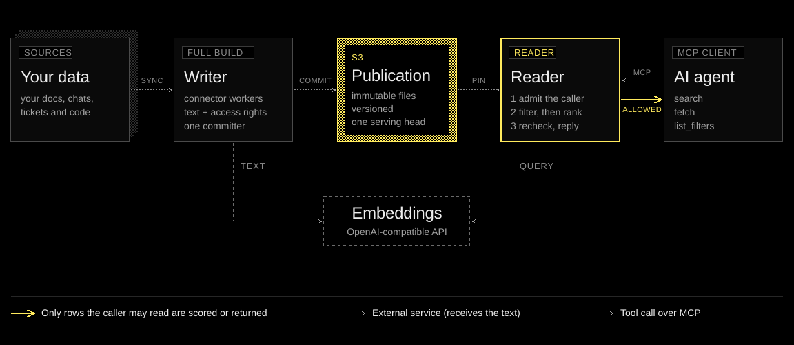

# fyrr

**Permission-aware search for AI agents.** fyrr indexes your company's
documents together with who may read them and serves them over the Model
Context Protocol (MCP), so every search hit and fetched document is one the
calling user is allowed to read.

[](LICENSE)
[](rust-toolchain.toml)



An agent that searches Drive, Slack, Jira or GitHub on a user's behalf must
not show that user a document they could not open themselves, yet a search
index built with one service account sees everything. fyrr syncs each
source's access rights along with its content and checks the caller's
rights inside the search itself, before anything is ranked or returned.
The index lives in an S3 bucket or a private local directory, with no
database or cluster to operate.

## Highlights

- **Storage is a bucket or a directory.** No database, queue or search cluster: the
  index, permissions and writer coordination live in S3 or on local disk.
  Writers run as scheduled commands or one `fyrr writer serve`; readers
  read publications and keep local caches ([topology](docs/deployment.md#topology)).
- **Permission filter before ranking.** Candidates come only from rows the
  caller may read, so a forbidden document is never scored or returned and
  looks exactly like one that does not exist ([how](docs/architecture.md#authorization)).
- **Fails closed.** Missing authorization data, an unknown caller or a source
  whose permission reads went stale refuses or hides; it never guesses
  ([security](docs/security.md)).
- **Consistent published snapshots.** Each request reads one immutable
  publication. Authorization uses the latest published permissions, so a
  revocation at the source takes effect after the next sync and commit
  ([publication](docs/architecture.md#publication)).
- **Hybrid retrieval.** BM25 full-text and vector search over Lance on S3,
  fused, grouped per document, optionally reranked ([retrieval](docs/architecture.md#retrieval)).
- **MCP over stdio or HTTP.** `search`, `fetch` and `list_filters` for one
  user per stdio process, or for many over Streamable HTTP with OIDC access
  tokens ([MCP tools](docs/mcp-tools.md)).
- **Connectors and an SDK.** Local files, Google Drive, Notion, GitHub, Slack
  and Jira, plus a Python SDK for your own ([connectors](docs/connectors/README.md)).
- **Two builds of one binary.** The full build syncs and publishes; the
  reader-only build serves and links no Python ([images](docs/deployment.md#images)).
- **Operations.** Scheduling, monitoring, restore and rollback, source
  retirement and purge, directory sync from Keycloak, SCIM or a snapshot
  ([deployment](docs/deployment.md), [operations](docs/operations.md)).

## Quick start

Search a folder of Markdown from Claude Code, using a private directory
on your machine. No Docker, accounts or embedding keys are needed. You need
Linux x86-64 and the [build prerequisites](CONTRIBUTING.md#build-host), except
Docker. Run from the repository root in one shell:

```sh
scripts/doctor --local
export PATH="$HOME/.cargo/bin:$PATH"
cargo build --locked -p fyrr
export PATH="$PWD/target/debug:$PATH" VIRTUAL_ENV="$PWD/connectors/.venv"
python3 examples/quickstart/toy-embeddings.py &  # word matching, no model

mkdir -p "$HOME/.config/fyrr"
export FYRR_CONFIG="$HOME/.config/fyrr/quickstart.toml"
python3 - "$HOME" "$FYRR_CONFIG" <<'PYCONFIG'
from pathlib import Path
import json, sys
text = Path("examples/quickstart/fyrr.toml").read_text()
uri = (Path(sys.argv[1]) / ".local/share/fyrr/notes").as_uri()
text = text.replace('"file:///home/you/.local/share/fyrr/notes"', json.dumps(uri))
Path(sys.argv[2]).write_text(text)
PYCONFIG
export FYRR_IDENTITY_KEY="${FYRR_IDENTITY_KEY:-$(openssl rand -hex 32)}"  # keep for future sessions
fyrr config check
fyrr writer namespace create && fyrr writer sync && fyrr writer commit

claude mcp add fyrr --scope user \
  -e FYRR_IDENTITY_KEY="$FYRR_IDENTITY_KEY" \
  -- "$PWD/target/debug/fyrr" --config "$FYRR_CONFIG" reader serve
```

Ask Claude to "use fyrr search and fetch to find where the reader keeps its
mirror". [The quickstart](docs/quickstart.md) explains how to choose your own
Markdown folder, add Slack and see Ada/Grace permissions in action.
`examples/quickstart/run` verifies the local flow without Docker;
`examples/quickstart/run --s3` verifies it on the S3 fixture. For a
shared/production deployment using S3, see [deployment](docs/deployment.md).

## When not to use fyrr

- **You need a stable release.** fyrr is pre-1.0: storage formats and the
  MCP schema may break before 1.0; data is then republished, not migrated.
  Releases (binaries, images, the SDK wheel) are published from `v*` tags.
- **You need proven cloud connectors.** Google Drive, Notion, GitHub, Slack
  and Jira have been tested only against synthetic APIs, not real workspaces.
- **Your documents are not text.** There is no PDF, Office or image
  extraction.
- **You cannot send text to an embeddings service.** You provide an
  OpenAI-compatible `/embeddings` endpoint, and document and query text is
  sent to it.
- **You build on macOS or Windows.** Linux x86-64 is the only supported
  build host.
- **You need phrase queries.** The full-text index stores no term positions.
- **You want TLS built in.** The HTTP listener speaks plain HTTP; outside
  loopback it needs a TLS-terminating proxy.

## Documentation

| Page | Content |
| --- | --- |
| [Quickstart](docs/quickstart.md) | The quick start above, step by step |
| [How fyrr works](docs/architecture.md) | Terms, publication, authorization and retrieval |
| [Security model](docs/security.md), [HTTP login and users](docs/http-users.md) | Trust boundaries, permissions, secrets; enrolling HTTP users |
| [Deployment](docs/deployment.md), [Operations](docs/operations.md) | Production setup, images, scheduling; monitoring, restore, upgrades |
| [Configuration](docs/configuration.md), [identity](docs/identity.md), [tuning](docs/tuning.md), [reader and writer](docs/reader-writer.md) | Configuration reference |
| [CLI](docs/cli.md), [MCP tools](docs/mcp-tools.md) | Command and tool references |
| [Connectors](docs/connectors/README.md) | Setup and limits per source; [writing a provider](docs/connectors/authoring.md) |

## Contributing

Bug reports, connector requests and pull requests are welcome; for larger
changes, open an [issue](https://github.com/fyrr-ai/fyrr/issues/new/choose)
first. [CONTRIBUTING.md](CONTRIBUTING.md) covers the build, `scripts/ci` and
the contract rules. Report vulnerabilities privately as described in
[SECURITY.md](SECURITY.md), and follow the
[code of conduct](CODE_OF_CONDUCT.md). Notable changes are listed in the
[changelog](CHANGELOG.md).

## License

fyrr is licensed under the [Apache License 2.0](LICENSE); see [NOTICE](NOTICE).
