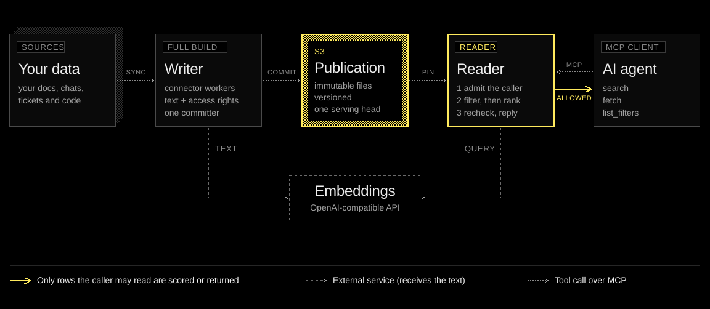

# How fyrr works

> **In short**
>
> - fyrr has two halves, a writer and a reader, that share nothing but an S3
>   prefix or a local directory.
> - This page defines the terms the other pages use and explains publication,
>   authorization and retrieval.
> - Read it when you want to know what happens between a sync and a search
>   result.

fyrr has two halves that share nothing but an S3 prefix (`storage.uri`), or
on a single host a [local directory](configuration.md#local-storage):

- The **writer** (full build) runs connector providers, prepares their
  output and publishes it.
- The **reader** (reader-only build, or the full build) serves the published
  data over MCP. The reader-only build links no Python and no writer code;
  `scripts/check-reader-only` proves it in CI.

## Terms

| Term | Meaning |
| --- | --- |
| namespace | One deployment's data under `storage.uri`, named by `namespace.name`. Every writer and reader of a deployment uses the same namespace. |
| source | One `[[sources]]` entry: a connector type, what it syncs (`scope`) and how its readers are decided (`permissions`). |
| reader token | A user or group grant on a row: `usr:<id>` or `grp:<id>`. Stored only as an HMAC digest. Not to be confused with OIDC access tokens, which authenticate HTTP callers. |
| publication | One immutable, published version of the namespace: the Lance content plus the policy and identity it is served with. |
| serving head | The single control object that names the current publication, policy and identity. Each commit replaces it in one conditional write. |
| pin | The publication one request reads from start to finish. |
| envelope | A durable batch a sync has validated and embedded, waiting for the committer to publish it. |
| mirror | The reader's local cache of immutable published files (`reader.mirror_path`). |
| admission | The reader's check, at the start of every request, that the caller is known and the pinned publication may be served. |
| Lance | The table storage and retrieval engine used for published text, vectors and indexes. |
| `root_id` / `record_id` | A source's stable document ID / the ID of one text record within that document. |
| principal / canonical user | The deployment's user identity to which source accounts and authenticated subjects are linked. |
| committer | The writer holding the namespace lease while publishing prepared work. |
| incarnation | A new identity assigned when a namespace is created, distinguishing it from earlier namespaces at the same URI. |
| freshness deadline | The maximum age of a successful permission, membership or directory read before its grants stop being served (`identity.validity_deadline`). |
| quarantine | Withholding an invalid document revision while retaining its last good published revision, if any. |
| provider | A connector provider reads source content and access rights; a directory provider supplies canonical users and groups; an embeddings or reranker provider processes text for retrieval. |

## Publication

1. **Sync.** `fyrr writer sync` runs each source in its own worker process
   under an expiring S3 lease per source and sync kind. Every batch is
   validated against the connector contract (Arrow schema, row rules, cursor
   chain, size bounds), embedded, and written as a durable envelope. The
   source's cursor advances only after its envelope is durable. An invalid
   or oversized document is quarantined and its last good revision stays
   visible.
2. **Commit.** `fyrr writer commit` takes the namespace lease, which lives
   in the serving head; a second committer exits instead of waiting. The
   committer publishes permission and membership changes before content,
   appends rows and index deltas to the Lance dataset, writes an immutable
   content manifest and replaces the serving head with one conditional
   write (compare-and-swap on the object version). A failed conditional
   write leaves the writer refusing to continue (`head_cas_failed`).
3. **Serve.** Each reader request pins one publication. Readers notice new
   publications in the background (`reader.version_check_interval`, 30 s,
   or `SIGHUP`) and switch between requests; in-flight requests keep their
   pin. Each request checks its grants against the serving head before it
   starts and before it answers, as the latest version check read it, so a
   published change of grants reaches a reader with its next version
   check, at the latest two intervals after it was published. A
   reader whose pin predates a published revocation it has seen stops
   serving until it has prepared the newer publication. Each namespace creation
   writes a new random incarnation into the serving head and every
   publication; a reader whose pin belongs to a namespace that was deleted
   and created again at the same storage URI stops serving when it next
   reads the head and prepares the new namespace's publication.

Published versions are retained for `writer.purge_window` and can be
restored; see [operations](operations.md#restore-and-rollback).

Every artifact carries a `major.minor` contract version. An unknown major
is refused with `publication_invalid` at startup or
`authorization_unavailable` on a live request. A publication whose indexes
or retrieval policy do not match is refused with `incompatible_index`. The exact formats are generated into `schemas/`
and `fixtures/`.

## Local storage

A `file://` root stores the same namespace objects and Lance dataset as S3.
Each write stages its object in `.fyrr-storage.stage.d/`, flushes it, gives
it its name with an atomic rename and flushes the directory before it
reports success. An object's version is a random 128-bit tag in an extended
attribute; an object without one is refused.

Writes to different objects never wait for each other. Creating an object
takes no lock. Replacing or removing one (the serving head, a lease, a
cursor) locks that object only for the comparison and the rename, never
while flushing. A process stopped inside that step blocks later changes to
that one object: they wait up to five seconds and then fail with
`storage_unavailable`, `head_cas_failed` or `sync_lease_lost`, depending on
the operation.

A reader can see an object before its writer has flushed the directory, so a
writer that publishes a reference to something it only observed flushes it
first. Lance uses an atomic create-exclusive link. Staging files of a killed
writer are removed by later writes and by every delete; a stopped writer
keeps its file. `.fyrr-storage.lock` remains in the root and stops earlier
releases, which serialized all writes through it, from writing there.
Maintenance and confirmed
source purge reap abandoned multipart uploads (`name#digits`), protecting
files younger than ten minutes and namespaces with live source leases;
purge plans count them as `namespace_staging_files`. Reader mirrors copy immutable files and preserve
in-flight pins across purge, bounded by `reader.mirror_max_bytes`.

## Authorization

The writer replaces every reader token with an HMAC-SHA256 digest keyed by
`identity.hashing_key` before it is stored. A published *identity artifact*
maps each subject (the stdio user, or an OIDC subject over HTTP) to the
hashed reader tokens it holds.

Every `search`, `fetch` and `list_filters` call passes three gates:

1. **Admission.** The reader checks the serving head, policy and
   identity. It checks the head its last version check read
   (`reader.version_check_interval`, 30 s), not a read of its own, so a
   warm request makes no storage request; a request reads the head itself
   only if that read is older than two intervals, which bounds how late
   a published change of grants takes effect. A malformed head, a head from another namespace, or missing or
   malformed policy or identity refuses with `authorization_unavailable`.
   An unreadable head or expired pin gives `storage_unavailable` on stdio.
   Admission also refuses a subject
   that is not in the identity artifact or holds more than
   `identity.max_tokens_per_user` reader tokens, and an expired directory
   read (`identity.validity_deadline`) when a directory provider is
   configured. A `permissions = "sync"` source whose last successful
   permission or membership read is older than `identity.validity_deadline`
   is excluded, and named in `metadata.hidden_sources` if the caller could
   otherwise read it. A retired source is excluded silently.
2. **Permission predicate.** Lexical and dense candidates are generated under
   a filter on the row's hashed readers, so a row the caller may not read is
   never scored, counted or returned. For `permissions = "fixed"` sources
   the filter checks the readers in the current policy, not the stored rows.
3. **Final check.** Before a result or error is returned, the reader checks
   the serving head again, as its latest version check read it. If the policy,
   identity or hidden sources it shows changed during the request, the
   request is refused rather than answered under the old grant.

Unknown and denied documents look the same to `fetch`: an empty result.
Source revocations require a successful sync that reads the changed rights
and a commit that publishes them; [in-run changes can be missed](security.md#source-polling).

## Retrieval

A `search` runs two candidate lanes over the permission-filtered rows:

- **lexical**: native full-text search (BM25) on the Lance `fts_idx` index;
- **dense**: IVF vector search on the query embedding. The query is embedded
  only after admission and only when `embedding.reader_live = true`;
  otherwise, or when the embedding call fails, the lexical lane answers
  alone and the response reports `degraded: ["dense"]`. Under a request
  filter, a small selection is scanned exactly and a large one is searched
  through the index ([tuning](tuning.md#dense-search-under-a-request-filter)).

The two score lists are normalized, fused (weight 0.5 lexical, 0.5 dense
by default) and grouped to one hit per document. A soft per-source cap
spreads the top of the list across sources; remaining slots may still come
from the same source. An optional reranker (`[namespace.rerank]`) reorders
the authorized documents. Excerpts are passages of up to 1200 codepoints
around the query terms; `fetch` returns whole documents or a window of one
record.

Fusion weights, depths, analyzer settings and composition enter one
retrieval-policy digest that is published with each version, so readers and
writers cannot silently disagree about ranking. The tuning keys are in
[tuning](tuning.md); the tool arguments and outputs are in
[MCP tools](mcp-tools.md).
